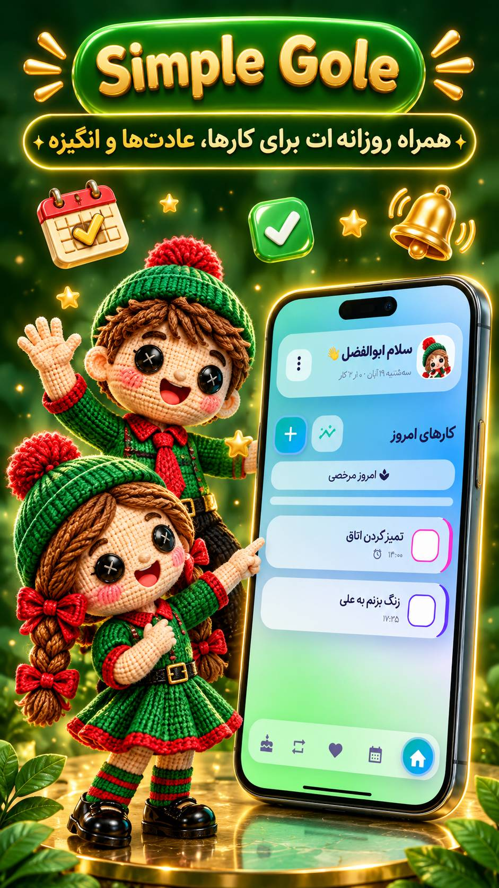
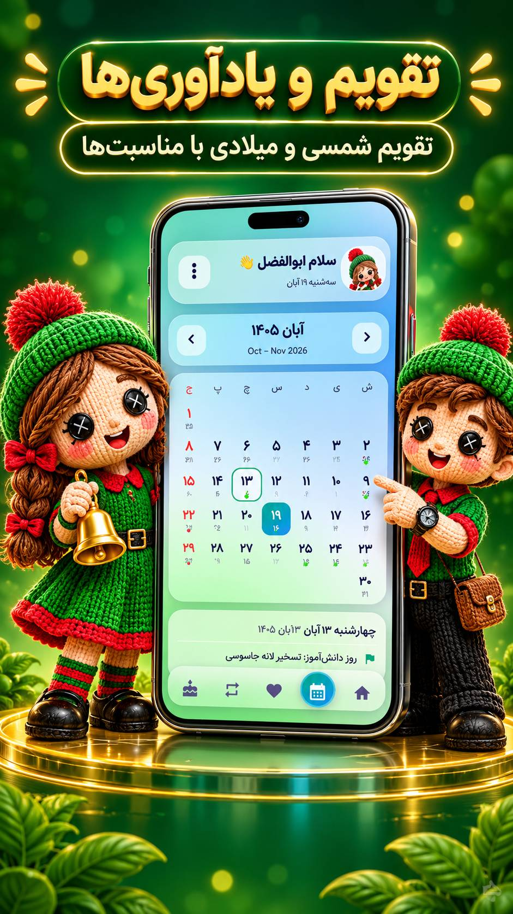
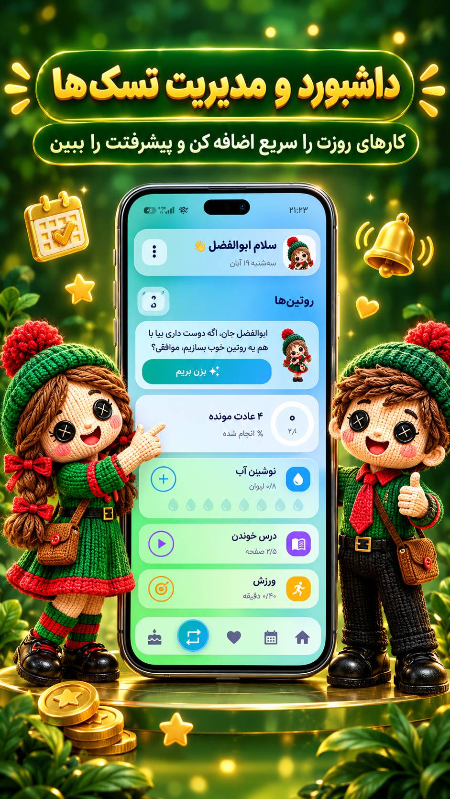
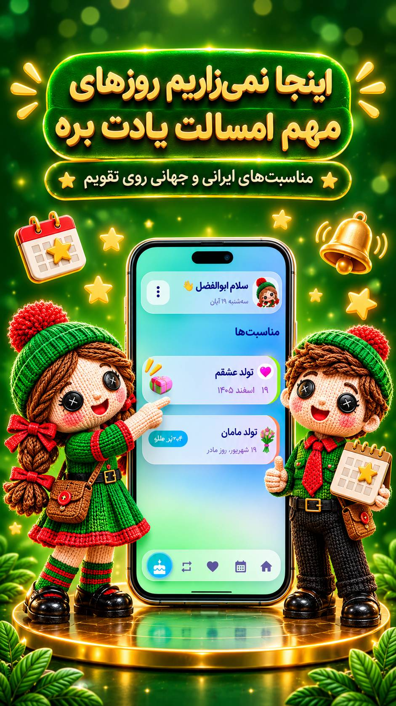

# هدف جو (Simple Gole) 🎯

**هدف جو** یک اپلیکیشن مدیریت کارهای روزانه است که با یک کاراکتر همراه ترکیب شده تا انجام کارها و ساختن عادت‌های خوب، دیگر خسته‌کننده و خشک نباشد. 

بسیاری از ما لیست کار می‌سازیم، چند روز استفاده می‌کنیم و بعد رهایش می‌کنیم؛ چون هیچ چیزی تشویقمان نمی‌کند. **هدف جو این حلقه را می‌شکند.** کاراکتر همراه (لی‌لی یا لویجی) با انجام هر کار تشویقت می‌کند، جمله‌های انگیزشی مخصوص صبح و شب می‌گوید و با تعامل با او (نوازش، قلقلک، غذا دادن) سکه می‌گیری و سطحت بالا می‌رود.

> **هدف جو — هدف‌هایت را با هم جلو ببریم.**

## ✨ قابلیت‌های اصلی

- 📝 **تسک‌های روزانه:** افزودن سریع کارها، تیک زدن و مشاهده پیشرفت با تنظیم ساعت دقیق (مانند ساعت موبایل).
- 📅 **تقویم شمسی و میلادی:** نمایش مناسبت‌های ایرانی و جهانی برای هر روز. کافی است روی هر روز کلیک کنید تا مناسبت آن را ببینید.
- 🔔 **یادآوری‌های هوشمند:** تنظیم دقیق زمان و انتخاب روز دلخواه برای فراموش نکردن کارها.
- 🔄 **روتین‌های تکرارشونده:** ساخت عادت‌های همیشگی (مثل زمان قرص خوردن یا ۸ لیوان آب) و پیگیری آن‌ها.
- 🎮 **تعامل با کاراکتر:** نوازش، قلقلک و غذا دادن به کاراکتر با واکنش‌های متحرک و انیمیشن‌های جذاب.
- 🪙 **سیستم سکه و بازی:** انجام بازی‌های چالشی برای کسب سکه و خرید غذا برای کاراکتر.
- 📊 **آمار روزانه:** مشاهده پیشرفت روزانه با نمودارهای جذاب و دریافت جملات انگیزشی.
- 🏦 **مدیریت مالی:** ثبت پس‌انداز، قبوض و بدهی‌ها با قابلیت جستجو و فیلتر در تاریخچه پرداخت‌ها.

## 🛠 تکنولوژی‌های استفاده شده

- **فرانت‌اند اپلیکیشن:** `React Native` (کراس‌پلتفرم برای اندروید)
- **زبان برنامه‌نویسی:** `JavaScript` / `TypeScript`
- **طراحی رابط کاربری:** با تمرکز بر انیمیشن‌های روان، فونت نرم (پفک) و طراحی دوستانه
- **پایگاه داده محلی:** برای ذخیره‌سازی ماندگار اطلاعات کاربران

## 📱 تصاویر محیط برنامه

| صفحه اصلی و تسک‌ها | تقویم و یادآوری‌ها | روتین‌ها (عادت‌ها) |
|:---:|:---:|:---:|
|  |  |  |

| مناسبت‌ها و رویدادها | بنر اصلی برنامه |
|:---:|:---:|
|  |  |

## 🚀 دانلود

اپلیکیشن **هدف جو** هم‌اکنون در مایکت در دسترس است. می‌توانید آخرین نسخه را از طریق لینک زیر دریافت کنید:

👉 **[دانلود هدف جو از مایکت](https://myket.ir/app/com.example.reminder)**

## 👨‍💻 نقش من در توسعه پروژه

من **ابوالفضل** (Abolfazl) هستم، توسعه‌دهنده‌ی این پروژه.

- **ایده‌پرداز و توسعه‌دهنده ارشد:** ایده‌ی اولیه، طراحی مکانیک‌های گیمیفیکیشن (کاراکتر، سکه، الماس) و سناریوی رفتاری کاراکترها کاملاً توسط من طراحی شده است.
- **توسعه فرانت‌اند:** پیاده‌سازی کامل رابط کاربری، انیمیشن‌ها و منطق اپلیکیشن با استفاده از **React Native** توسط من انجام شده است.
- **مدیریت پروژه:** مستندسازی مراحل تولید و توسعه‌ی این پروژه به صورت ویدیویی در [کانال یوتیوب من](https://www.youtube.com/@MRDUCK286) ثبت شده است.

از ۱۴ سالگی با پایتون شروع کردم و بعدها به سمت توسعه وب و موبایل رفتم. این اپلیکیشن یک ایده‌ی کاملاً شخصی است که با تلاش و پشتکار خودم به مرحله‌ی انتشار رسیده است.

## 🌐 ارتباط با من

- **یوتیوب:** [@MRDUCK286](https://www.youtube.com/@MRDUCK286)
- **گیت‌هاب:** [Abolfazldh289](https://github.com/Abolfazldh289)
- **اینستاگرام:** [@abolfazldh13](https://www.instagram.com/abolfazldh13)
- **تلگرام:** [@Abolfazldh289](https://t.me/Abolfazldh289)

---
*ساخته شده با ❤️ برای کمک به شما در ساختن عادت‌های بهتر و رسیدن به اهداف.*
